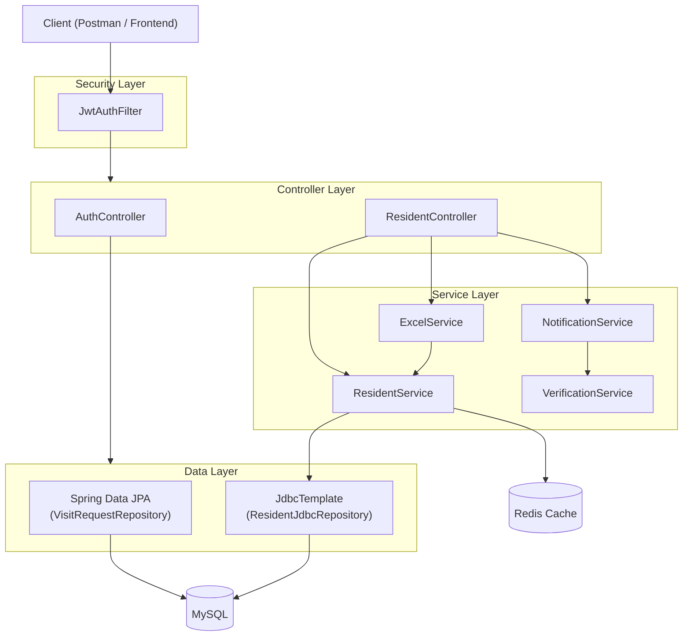
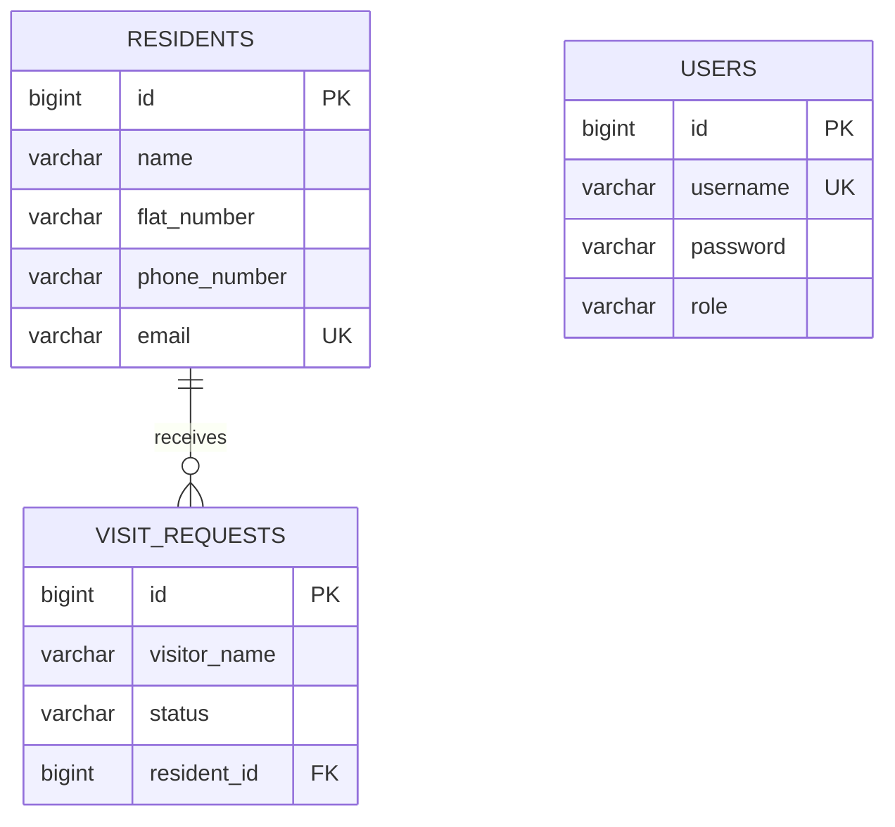

# Society Visitor Management System

A Spring Boot proof-of-concept for managing residents and visitor requests in a housing society, built to demonstrate a layered, production-style architecture.

## Tech Stack

- **Java 21**, **Spring Boot 4.1.1**
- **MySQL** (primary datastore) + **Flyway** (schema migrations)
- **Spring Data JPA** and **JdbcTemplate** (used side-by-side intentionally — see Architecture)
- **Redis** (response caching)
- **Spring Security + JWT** (stateless, role-based auth)
- **Apache POI** (Excel import)
- **Bean Validation** (request validation)

## Architecture



## Features

| Feature | Description |
|---|---|
| DTO layer | Controllers only ever see DTOs, never JPA entities |
| Bean Validation | `@Valid` + custom messages on all write endpoints |
| JdbcTemplate repository | `ResidentJdbcRepository` — raw SQL alongside JPA, to demonstrate both approaches |
| Transactions | `@Transactional` bulk-create with automatic rollback on duplicate email |
| Redis caching | `@Cacheable` / `@CacheEvict` on resident reads and writes |
| Async processing | `@Async` background notification on resident creation |
| CompletableFuture | Parallel email + phone verification (`GET /api/residents/{id}/verify`) |
| Excel upload | Bulk-import residents from a `.xlsx` file |
| Spring Security (JWT) | Role-based access — `ADMIN` (full access) vs `RESIDENT` (read-only) |

## Database Schema



## Getting Started

### Prerequisites
- Java 21
- Maven
- MySQL running locally, with a `society_vms` database
- Redis running locally (default: `localhost:6380` — see `application.properties`)

### Run

```bash
mvn clean install
mvn spring-boot:run
```

Flyway runs migrations automatically on startup. A `DataSeeder` also creates two default users on first run:

| Username | Password | Role |
|---|---|---|
| `admin` | `admin123` | ADMIN |
| `resident` | `resident123` | RESIDENT |

## API Overview

### Auth
- `POST /api/auth/login` — returns a JWT token

```mermaid
sequenceDiagram
    participant C as Client
    participant AC as AuthController
    participant DB as MySQL (users)
    participant J as JwtUtil

    C->>AC: POST /api/auth/login {username, password}
    AC->>DB: findByUsername(username)
    DB-->>AC: User (hashed password, role)
    AC->>AC: passwordEncoder.matches()
    AC->>J: generateToken(username, role)
    J-->>AC: JWT token
    AC-->>C: 200 OK { token, username, role }

    Note over C: Client stores token,
sends it as
Authorization: Bearer <token>
on every later request
```


### Residents
- `GET /api/residents` — list all (ADMIN or RESIDENT)
- `GET /api/residents/{id}` — get one (ADMIN or RESIDENT)
- `GET /api/residents/{id}/verify` — parallel email/phone verification demo (ADMIN or RESIDENT)
- `POST /api/residents` — create (ADMIN only)
- `POST /api/residents/bulk` — bulk create with rollback-on-duplicate (ADMIN only)
- `POST /api/residents/upload-excel` — bulk create from an Excel file (ADMIN only)
- `PUT /api/residents/{id}` — update (ADMIN only)
- `DELETE /api/residents/{id}` — delete (ADMIN only)

All endpoints except `/api/auth/**` require a `Bearer <token>` in the `Authorization` header.

### Excel Upload Format

`.xlsx` file with a header row, columns in this order:

| Name | FlatNumber | Email | Phone |
|---|---|---|---|
| Rahul Sharma | A-101 | rahul@test.com | 9876543210 |

## Architecture Notes

- **Dual persistence (JPA + JdbcTemplate):** `VisitRequestRepository` uses Spring Data JPA; `ResidentJdbcRepository` uses raw `JdbcTemplate` — kept side-by-side deliberately to demonstrate both patterns.
- **Self-invocation and Spring proxies:** `@Async`/`@Transactional`/`@Cacheable` only take effect on calls that go through Spring's proxy (i.e., from another bean). `NotificationService` → `VerificationService` is split into two classes for exactly this reason — calling `@Async` methods from within the same class silently runs them synchronously.
- **JwtAuthFilter registration:** `JwtAuthFilter` is a `@Component`, which Spring Boot would otherwise also auto-register as a global servlet filter (outside the Security filter chain), resetting the security context before authorization checks run. A `FilterRegistrationBean` with `setEnabled(false)` disables that duplicate registration; the filter still runs correctly via `addFilterBefore()` in `SecurityConfig`.

## Known Limitations

- No OpenAPI/Swagger docs — the current `springdoc-openapi` releases aren't yet compatible with Spring Boot 4 / Spring Framework 7 ([tracking issue](https://github.com/springdoc/springdoc-openapi/issues/2944)).
- No automated test coverage beyond the generated Spring Boot context test.
- JWT secret key is generated in-memory per app start (demo-only) — not suitable for production or multi-instance deployments.
